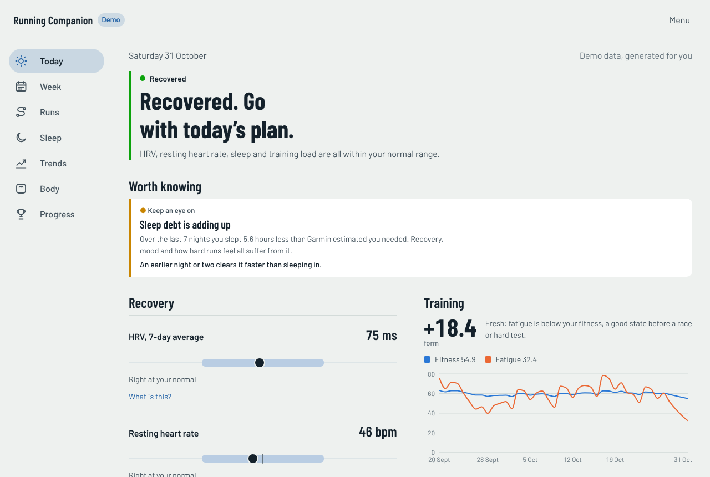
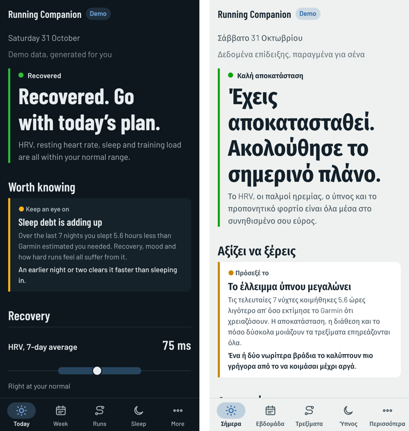
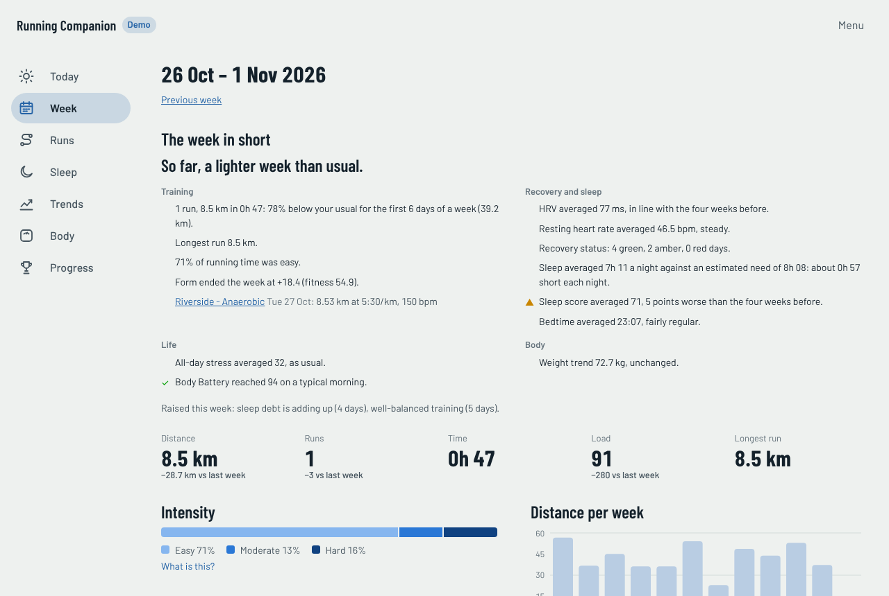
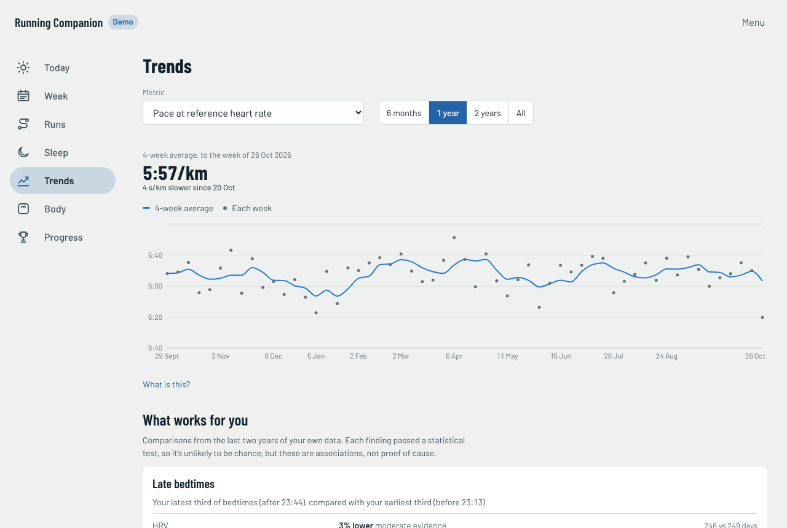
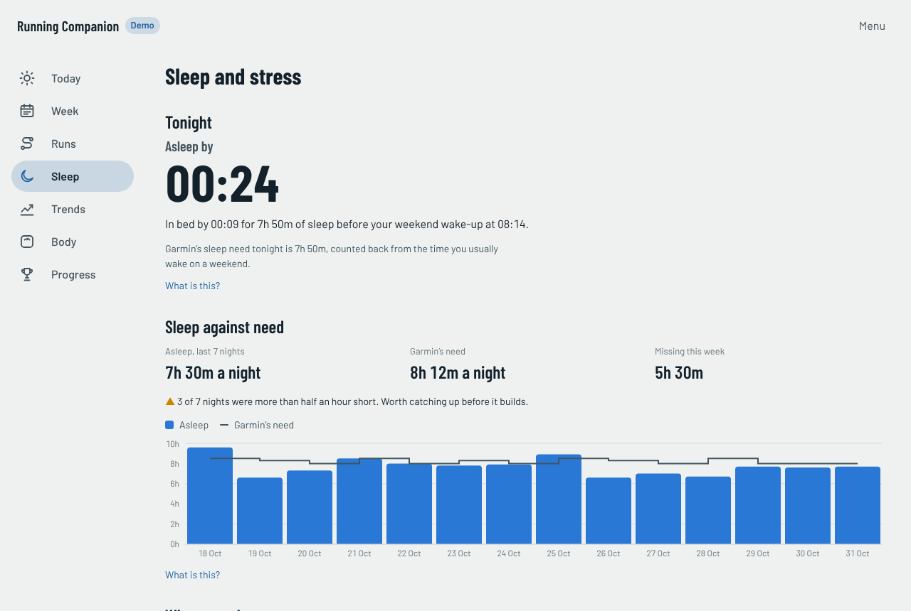
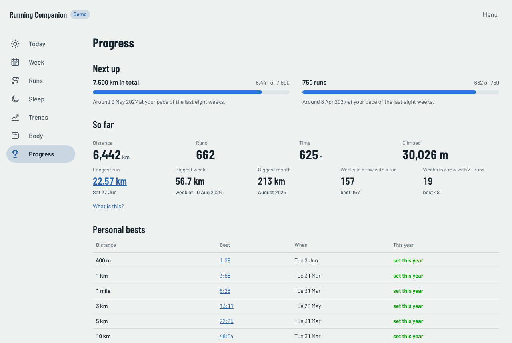

# Running Companion

Personal running and health dashboard built on Garmin's official, read-only Personal API.
Everything runs locally: the API key and the database stay on this machine. The exception is the AI chat integration (see Privacy).
It runs only on what the watch records: there is nothing to type in. Races, race predictions and training plans stay in
Garmin Connect, which remains the coach.



<p align="center"></p>

| Week | Trends |
|---|---|
|  |  |
| **Sleep** | **Progress** |
|  |  |

All screenshots are from the [demo](#demo), with generated data.

## Stack

| Part | Tech |
|---|---|
| Garmin API client | TypeScript, native `fetch` |
| FIT file decoding | `@garmin/fitsdk` (Garmin's official JS SDK) |
| Database | SQLite via Node's built-in `node:sqlite` |
| Sync (backfill + incremental) | TypeScript |
| Metrics engine | TypeScript |
| MCP server (chat with an AI assistant about the data) | `@modelcontextprotocol/sdk` |
| Web server (API, remote MCP with OAuth, scheduled sync) | Express 5, MCP SDK auth |
| Dashboard (PWA) | React 19, Vite, React Router, TanStack Query, Recharts, CSS Modules |
| Deployment | Docker image (amd64, arm64) with Compose files for Tailscale Funnel or Caddy |

## Layout

```
packages/
  garmin-client/   API key → bearer token exchange, token cache, typed endpoints, throttling
  db/              SQLite connection, migrations (db/migrations/NNN_*.sql), upsert helpers
  sync/            raw JSON → rows (mappers), FIT parsing, date-range walker, sync orchestration
  metrics/         derived metrics: run type, load, intensity, efficiency, best efforts, recovery status
  mcp/             MCP server for Claude Desktop: read-only tools over the database, plus an on-demand sync
  insights/        signals, personal patterns, reports, sleep, body, progress (statistics without dependencies)
  weather/         Open-Meteo client, heat model, weather backfill and forecast
  queries/         read-only queries shared by the dashboard API and the MCP tools
  jobs/            single-flight Garmin sync + metrics, database preparation, read-only connections
  server/          web server: login, OAuth for Claude, /api, /mcp over HTTP, scheduled sync
  web/             dashboard PWA (React); `npm run build` writes packages/web/dist, which the server serves
  config/          project paths, .env loading, the settings file
  demo/            generated demo runner, written into the same tables a sync fills
  dates/           calendar dates (YYYY-MM-DD): arithmetic in UTC, "today" in a time zone
  i18n/            messages in English and Greek, units, number and date formatting (shared by server and app)
  cli/             command line entry points: sync, metrics, discover, auth:check, demo
data/              your data (gitignored)
  companion.db       the database
  settings.json      password hash, session secret, Garmin key (owner-only; written by the setup page and Settings)
  backups/         daily automatic backups, and npm run backup's
  fit/             original FIT file of every activity
.cache/            bearer token cache (gitignored)
```

## Setup

Requires Node 26 or newer (see `.nvmrc`). With nvm-windows: `nvm use 26.13.0`.
Node 26 runs the server's TypeScript sources directly (type stripping), so the server has no build step; only the dashboard is built (`npm run build`). `erasableSyntaxOnly` in `tsconfig.json`
rejects the few TypeScript features Node can't strip (enums, parameter properties, namespaces).

```sh
npm ci
npm run build
npm start
```

The server's log prints a setup link (`/setup?code=…`). Open it, choose a password and paste your Garmin key, which you
create at <https://connect.garmin.com/app/settings/personalApiToken> (Garmin shows it only once; note the expiry date
it shows too, and the app will remind you two weeks before). The first sync starts straight away. Everything set there
can be changed later under Settings. No config file is needed; `.env.example` lists what the server optionally reads.

## Demo

`npm run build`, then `npm run demo`, then open http://localhost:8788. It's the whole app on a made-up runner with three
years of runs (per-second records, laps, workouts), sleep, HRV, stress, Body Battery, weigh-ins and weather, generated
the same way every time. Nothing syncs, nothing can be changed, and there's no login, so it's safe to show anyone.

The same generator checks how the app copes with less data, as from other watches or setups:

```sh
npm run demo -- --missing hrv,power,dynamics   # an older watch
npm run demo -- --missing scale,sleep           # no smart scale, watch off at night
npm run demo -- --days 42                       # six weeks in
```

Streams that can be left out: `dynamics`, `power`, `hrv`, `scale`, `battery-events`, `sleep`, `gps`, `fitness-age`.
Each variant lives in its own folder under `.demo/` (gitignored) and is made again when the day changes.

## Languages and units

The app is in English and Greek, in kilometres or miles (with °C/°F and kg/lb to match). Both follow the device:
a Greek phone gets Greek, a US one gets miles. Settings → Language and units changes either one on that device. The
login and setup pages follow the browser's language. Requests to Claude stay in English, the language the connector's
tools are documented in, and ask Claude to answer in yours.

All text lives in `packages/i18n/src/messages/`, one file per area, English and Greek side by side. The Greek has to
match the English exactly, key for key and parameter for parameter, or the typecheck fails; a test also checks
nothing is missing or empty. Numbers, units and dates go through `packages/i18n/src/format.ts` (`f.distance`,
`f.pace`, `f.longDay`…), never `toFixed` or a hard-coded "km". To add a language: add its code to `LANGS` in
`locale.ts`, its name to `LANG_NAMES`, and a third object to each `define(...)` once `define` takes it (today it
takes two).

## Commands

| Command | What it does |
|---|---|
| `npm run up` | Turns the app on, on this laptop: connects Tailscale, pulls and builds new commits, starts the server (with a sync), opens the public address. Ctrl+C or closing the window turns all of it off |
| `npm run down` | Turns everything off from any terminal, including leftovers if the `up` window was killed |
| `npm run demo` | Runs the app on generated data on http://localhost:8788: no Garmin key, no login, nothing of yours (see [Demo](#demo)) |
| `npm start` | Starts the web server: dashboard, `/api`, remote `/mcp`, scheduled sync (default http://localhost:8787) |
| `npm run build` | Builds the dashboard into `packages/web/dist` (run after every pull that changes `packages/web`) |
| `npm run dev:web` | Dashboard with instant reload on http://localhost:5173, proxying `/api` to a running `npm start` |
| `npm run set-password` | Sets a new login password from the server's terminal (forgot it?); logs out every browser |
| `npm run sync` | First run: downloads all available history. Later runs: only what's new (plus the last 3 days, which Garmin finalises late) |
| `npm run sync -- --since 2023-01-01` | Backfill down to a date, even through months without data |
| `npm run sync -- --only sleep,hrv` | Sync some streams only: `activities`, `daily_wellness`, `sleep`, `hrv`, `weigh_ins` |
| `npm run sync -- --max-chunks 5` | Limit backfill per stream in this run; the next run continues |
| `npm run sync -- --delay 500` | Milliseconds between API requests (default 250) |
| `npm run backup` | Backs up the database, settings and FIT files into `data/backups/` (see [Backups](#backups)) |
| `npm run restore -- <file>` | Restores a backup, with the app stopped; what was there moves aside, nothing is deleted |
| `npm run metrics` | Recomputes metrics (sync already does this at the end) |
| `npm run metrics -- --full` | Recomputes every activity, e.g. after changing a formula |
| `npm run mcp:install` | Registers the MCP server with Claude Desktop (backs up the existing config) |
| `npm run mcp:install -- --print` | Prints the config entry instead of writing it |
| `npm run mcp:doctor` | Checks the setup step by step: config, Node, server start, a tool call, and the end of the server log |
| `npm run auth:check` | Confirms the key works. Prints nothing secret |
| `npm run discover` | Calls every endpoint, decodes your latest run's FIT file, writes `data/discovery/REPORT.md` |
| `npm test` | Unit tests (synthetic data only) |
| `npm run typecheck` | Type-checks all packages |

## How the data is stored

Three layers:

1. **`raw_responses`**: every API response exactly as received. New columns can be filled from it later without re-downloading.
2. **Typed tables**: `activities`, `activity_laps`, `activity_records` (one row per second), `daily_wellness`, `sleep`, `hrv`, `weigh_ins`, `profile_snapshots`.
3. **Derived metrics**: `activity_metrics`, `activity_best_efforts`, `daily_metrics` and the `weekly_summary` view.
   Always recomputable from layers 1–2; formulas are documented in `packages/metrics/src`.

Conventions: units in column names in base units (`distance_m`, `weight_kg`, `gct_ms`), `calendar_date` as local `YYYY-MM-DD`,
timestamps as UTC milliseconds, `STRICT` tables. Schema changes are new numbered files in `packages/db/migrations/`; never edit an applied one.

## Metrics and their assumptions

| Metric | Formula | Main assumption |
|---|---|---|
| Run type | Planned workout name, else Garmin training effect, else duration (75+ min = long) | Intent, not what happened; compare with the intensity split |
| Load (TRIMP) | Banister: Σ minutes × HRr × 0.64 × e^(1.92·HRr) | Max HR and resting HR are right |
| Intensity split | Time below LT1 / between LT1 and LTHR / above LTHR | LT1 ≈ 88% of Garmin's LTHR (no lab test) |
| Efficiency | Speed ÷ HR after the first 10 min, as metres per heartbeat | Comparable only between similar runs (use easy runs) |
| Pace at reference HR | Median speed while HR is within ±3 bpm of 85% LTHR | Fixed reference across all history |
| Decoupling | Efficiency drop from first to second half, steady runs of 30+ min | Flat routes; heat inflates it |
| Best efforts | Fastest window per distance inside each run | GPS distance; short distances can be flattered by a second or two |
| Fitness / fatigue / form | 42-day and 7-day exponentially weighted load; form = yesterday's fitness − fatigue | Population constants, not fitted to you |
| Recovery status | HRV, resting HR, sleep, load compared with your own 60/28-day baselines; red needs 2 systems | Rules of thumb; complements Garmin, doesn't replace it |

Thresholds come from the latest Garmin profile and are applied to all history so trends share one yardstick.

## Chatting about the data (MCP)

`npm run mcp:install`, then fully quit and restart Claude Desktop. Claude Desktop starts `packages/mcp/src/server.ts` itself when needed.

| Tool | What it answers |
|---|---|
| `get_today` | Recovery status with reasons, HRV, resting HR, sleep, fitness/fatigue/form, weight trend, fitness age, last run, data freshness |
| `get_weekly_summary` | Week-by-week volume, load, intensity split, efficiency, sleep, HRV, weight |
| `list_activities`, `get_activity` | Runs with formatted pace and metrics; one run in full with planned workout steps, laps and best efforts |
| `get_best_efforts` | Fastest 400 m to marathon inside any run |
| `get_trend` | One metric per week or month (fitness, HRV, sleep, weight, pace at reference HR, efficiency, …) |
| `describe_data`, `query` | Schema, units, formulas and caveats; read-only SQL for anything else |
| `get_weekly_report` | The computed report for a week; Claude's weekly review starts from it |
| `get_sleep_stress_report` | Four weeks of nights, tonight's suggested bedtime, sleep debt against Garmin's need, timing regularity, stages; Body Battery charged vs drained and what drives it, stress minutes, workdays vs weekends |
| `get_run_forecast` | Today's and tomorrow's hourly weather where you usually run, the heat cost of each hour, the best window and the hour to avoid |
| `get_progress` | Totals, milestones, next milestones, records, streaks, personal bests; a year in review; running form by month |
| `get_body_report` | Weight trend against the goal and whether the pace is healthy, composition, energy by day type, your sweat rate, daily protein and carbohydrate ranges |
| `get_insights` | Today's signals and your personal patterns, with sample sizes, p-values adjusted for the number of comparisons, and effect sizes |
| `sync_garmin` | Pulls new data from Garmin and recomputes metrics |

Every tool reads through a read-only database connection (the weather forecast cache is the one write), so no tool
can change your data, and `query` stays SELECT-only. A `query` runs in its own process and is stopped after 15 seconds,
so a heavy one can't hold up the dashboard. Claude's answers stay in the Claude chat; the app doesn't store them.

**Claude on the web and phone** connects to the server instead: add a custom connector with the address shown in
Settings → Claude (`<PUBLIC_URL>/mcp`), and approve it with your password. The same place shows whether Claude is
connected and has a button that signs it out everywhere.

## Web server

`npm run build`, then `npm start`, then open the setup link from its log (first time) or http://localhost:8787.

| Path | Access | Purpose |
|---|---|---|
| `/healthz` | public | Up or not, version, last sync time |
| `/setup` | setup code | First start only: password and Garmin key; every other page waits for it |
| `/api/settings` | session | Garmin key status and replacement, key expiry date, password change (the key is never sent back), Claude's connection and signing it out, backups |
| `/login`, `/logout` | public | Dashboard login (password, 10 attempts per 15 min) |
| `/.well-known/*`, `/authorize`, `/token`, `/register`, `/revoke` | public | OAuth 2.1 for Claude's connector (MCP SDK) |
| `/oauth/consent` | password | Login + "Allow" step of the OAuth flow |
| `/mcp` | OAuth token | The MCP tools over HTTP (stateless) |
| `/api/*` | session cookie | Dashboard JSON: `today`, `week`, `weeks`, `daily`, `baselines`, `activities` (`type`, `limit`, `offset`), `activities/:id`, `activities/:id/records`, `best-efforts`, `trend`, `sync` |
| everything else | public | The dashboard's static files (code only, no data), so the browser can install and update the app before you log in |

Security model: one user. The password is stored only as a scrypt hash; sessions are HMAC-signed HttpOnly SameSite=Lax cookies;
OAuth codes and tokens are stored as SHA-256 hashes, access tokens last 1 hour, refresh tokens 30 days and rotate on use;
every read uses a read-only database connection. Plain HTTP is only accepted for localhost: anything public must be HTTPS.

## Dashboard

An installable web app (PWA): open it in Chrome on Android and choose "Install app", or the install icon in the address bar on a laptop.
It gets its own icon and window, and the screens you opened recently stay readable offline.

- **Today**: the recovery verdict, HRV, resting HR and sleep drawn as a dot on your own typical range, fitness, fatigue and form;
  last night in detail (score, stages, bedtime, breathing rate and SpO2 against your normal); Body Battery, yesterday's stress,
  steps and weekly intensity minutes; when to run; last run; body with fitness age.
- **Week**: "The week in short" first: a headline and short lines on training, recovery and sleep, life and body (✓ good,
  ▲ worth attention, compared with the four weeks before), key sessions with planned vs actual, new personal bests, the
  signals raised that week. Then totals and the change from last week, intensity split, distance per week, a day-by-day table, recovery and body against last week, the runs.
- **Runs**: every run by month. A run's page has pace, heart rate, power and elevation over the distance (one chart each, one shared cursor),
  planned vs actual per workout step, laps, effort, efficiency, running form and the fastest efforts inside it.
- **Worth knowing** (on Today): signals from rules over your recent data, each with its numbers and what to do:
  possible illness (resting HR, HRV and breathing rate shifting together), Body Battery running down (draining more than it charges on most days while mornings start low), possible under-fuelling (weight dropping fast while recovery slips), overreaching, load spikes, a big jump in
  long-run distance, easy runs drifting above the first threshold, intensity balance, sleep debt, irregular bedtimes,
  stress streaks, and strong recovery.
- **What works for you** (on Trends): two years of your own data compared with a statistical test (Welch's t-test, effect
  size, and a Benjamini–Hochberg correction across all comparisons, so one fluke in two dozen tests isn't reported as a
  finding): late bedtimes, short nights, evening runs, hard sessions, stressful days, running after a short night, on a low
  Body Battery or in the heat. Findings, "no clear effect" and "waiting for data" are kept apart, each with a caveat.
- **Ask Claude**: buttons on Today, Week and each run open Claude with a ready request (train today?, health check,
  plan my week, fuel my long run, weekly review, run debrief). Claude works on your subscription through the connector.
- **Sleep** (sleep and stress): tonight's bedtime, from Garmin's sleep need counted back from your usual wake-up for
  tomorrow's kind of day; when that's far from your usual bedtime, a realistic first step of 30 minutes earlier instead.
  Sleep against need over two weeks and the week's debt; a four-week sleep diary (each night from falling asleep to
  waking, weekends marked); how much bedtime and wake-up vary and the weekday-to-weekend shift; stages against Garmin's
  ideal ranges. Body Battery charged against drained each day, what charges and drains it (sleep, naps, workouts,
  stress, everyday), stress minutes now against before, workdays against weekends, and the patterns that affect your sleep.
- **Body**: the weight trend against your Garmin goal (trend line, each weigh-in as a dot, goal as a dashed line), whether
  the pace is healthy for someone training (no faster than 0.5–1% of body weight a week) and when you'd reach the goal;
  body fat and muscle against a month ago, with a flag if muscle drops; fitness age and its biggest lever; calories on
  rest, training and big days; daily protein and carbohydrate ranges for your weight; a fuel planner (run length, hard,
  warm) for before, during and after. Ranges follow the sports-nutrition position stands (ACSM/AND/DC 2016, ISSN 2017);
  fluid amounts use your own sweat rate from Garmin's estimates. Guidance, not a diet.
- **Route and conditions** (on each run): the route on a map, coloured by pace (strong for your fastest stretches);
  the air temperature, dew point, humidity and wind at the time and place of the run (Open-Meteo, not the wrist
  sensor), the heat cost, and the pace the same effort is worth on a cool day. Heat cost follows Hadley's rule:
  temperature plus dew point in °F, no cost up to 100, rising to 8–10% at 171–180.
- **When to run** (on Today): the coolest dry window today and tomorrow where you usually run, and the hour to avoid.
- **Where you've run** (on Runs): every place you've started runs, on a map, sized by how many.
- **Fuel and fluids** (on each run): energy burned, sweat lost and its share of body weight, the run's sweat rate, and how
  to fuel a run like it.
- **Progress**: the next milestones with a rough date, totals, records (longest run, biggest week and month, weekly
  streaks), personal bests per distance, every milestone passed (distance, run counts, first times under round times),
  running form by month and a year in review (volume against the year before, kilometres per month, personal bests
  set, how resting heart rate, HRV, sleep and weight moved, when you ran, the hottest and coldest run).
  Running form compares easy outdoor runs at the same pace: each measure's slope against speed is estimated inside
  each month, then every month is moved to your typical easy pace; the summary compares the last three months with
  the same three a year earlier, and power gets no verdict because Garmin's power model changes with firmware.
- **Trends**: 27 metrics in six groups (training, aerobic fitness, recovery, sleep, daily life, body) over 6 months to all time. Weekly levels are drawn as a 4-week average with each week as a dot, because one or two runs a week make a single week noisy.

Updates are automatic: the server sends `index.html` and the service worker with `no-cache`, so the app checks for a new version on every
start and switches to it; the hashed files in `/assets/` are cached for a year since their name changes when their content does.
Libraries are built into their own `vendor` file, which only changes when a dependency is upgraded, so an ordinary update downloads about 15 KB.
Data requests go to the network first and fall back to the last answer only when offline. Logging out also deletes that offline copy.

Types run end to end: the dashboard imports the response types of `packages/queries` (type-only, erased at build), so a change
in what the server returns fails `npm run typecheck` instead of breaking a screen.

## Backups

The app backs itself up once a day: the first scheduled sync of the day (or the start, if it was off) writes
`data/backups/running-companion-auto-<date>.tar.gz` with the database and settings, and keeps the newest 7
(`BACKUP_KEEP`; 0 turns it off). Each is about a third of the database's size (three years of runs: about 50 MB). Those leave out the original FIT files, which are large and whose contents are all in the
database. `npm run backup` makes a full one by hand, FIT files included, and those are never removed automatically.

A backup is an ordinary `.tar.gz` (`tar -tzf` lists it): a `manifest.json` saying which version made it, a consistent
snapshot of the database (taken safely while the app runs), `settings.json` and the FIT files. **It holds your password
hash and Garmin key**, so it's written owner-only. A backup on the same disk doesn't survive that disk: copy them
somewhere else now and then.

To restore, stop the app (`npm run down`), then `npm run restore -- data/backups/<file>`. The current database, settings
and FIT files move into `data/before-restore-<time>/` first, so nothing is lost if it was the wrong file. A backup from an
older version is fine (the app updates the database when it starts); one from a newer version is refused until you
update. Claude's connection is in the database too, so it comes back as it was when the backup was made; if Claude was
connected after that, connect it again.

In Docker, the automatic backups are in the volume. By hand:

```sh
docker exec companion node packages/cli/src/backup.ts --out - > companion-backup.tar.gz
docker compose stop app
docker compose run --rm -T app node packages/cli/src/restore.ts - < companion-backup.tar.gz
docker compose start app
```

## Docker

Every release is published as an image for amd64 and arm64 (a Raspberry Pi 4 or 5 works):
`ghcr.io/dtsiakas/running-companion`. `latest` is the newest release, `0.1.0` (or `0.1`) pins one, and `edge` follows
`main`. Everything the app keeps (database, settings, Garmin token, FIT files) is in `/data`, so mount a volume there and
updating is just pulling a newer image.

```sh
docker run -d --name companion --init -p 127.0.0.1:8787:8787 -v companion-data:/data \
  -e TZ=Europe/Athens ghcr.io/dtsiakas/running-companion
docker logs companion        # the setup link
```

Set `TZ` to your time zone: the scheduled syncs and "today" follow it. The container runs as an unprivileged user,
reports its health to Docker (`/healthz`), and stops cleanly on `docker stop`. The demo is in the same image:

```sh
docker run --rm -p 127.0.0.1:8788:8788 ghcr.io/dtsiakas/running-companion \
  node --disable-warning=ExperimentalWarning packages/cli/src/demo.ts --port 8788
```

### With HTTPS

Claude's connector and the installable app both need HTTPS. `deploy/docker/` has three Compose files; copy that folder
to the server, copy `.env.example` to `.env`, fill in what the file you pick needs, and start it. The setup link is in
`docker compose -f <file> logs app`.

| File | Address | You need |
|---|---|---|
| `compose.yaml` | `http://localhost:8787`, this computer only | nothing |
| `compose.tailscale.yaml` | `https://<name>.<tailnet>.ts.net` through Tailscale Funnel | a Tailscale account; no domain, no open ports |
| `compose.caddy.yaml` | `https://<your domain>`, certificate from Let's Encrypt | a domain pointed at the server, ports 80 and 443 open |

**Tailscale:** in the admin console, create an auth key (Settings → Keys; reusable is easiest, so the container can
sign in again after its state is lost) and allow Funnel in the access controls (`"nodeAttrs": [{"target":
["autogroup:member"], "attr": ["funnel"]}]`, which the console offers to add the first time). Put the key in
`TS_AUTHKEY`, pick `TS_HOSTNAME`, and set `PUBLIC_URL` to the address the machine gets: it's shown in the admin
console as `<TS_HOSTNAME>.<tailnet>.ts.net`. The app shares the Tailscale container's network and listens on
127.0.0.1 only, so Funnel is the one way in.

**Caddy:** set `DOMAIN`. Caddy gets the certificate on first start and renews it on its own.

To update: `docker compose -f <file> pull && docker compose -f <file> up -d`. To pin a release instead of following
`latest`, set `COMPANION_TAG` in `.env`.

## Deploying to a server

Docker (above) is the simplest way. The alternative: `deploy/` puts the app on a fresh Ubuntu 24.04 server (an OVHcloud VPS-1 here), reachable at a free
`https://<name>.<tailnet>.ts.net` address through Tailscale Funnel. From the project folder on the laptop:

```sh
scp deploy/setup.sh ubuntu@<server IP>:
ssh -t ubuntu@<server IP> "sudo bash setup.sh"
```

The script is safe to run again, and every step checks what's already done. In order:

1. SSH accepts keys only, with passwords and root login off.
2. System updates, automatic security updates (reboot at 04:00 when one needs it), and a firewall with only SSH open.
3. An unprivileged `companion` user that runs the app.
4. A read-only GitHub deploy key, added once by hand.
5. The code in `/opt/running-companion`.
6. Node from `.nvmrc`, then install, typecheck, tests and build.
7. Tailscale and Funnel: the public HTTPS address, with no web port opened on the server.
8. The Garmin key and dashboard password, typed hidden on the server, into `data/settings.json` (mode 600).
9. The first sync, then the systemd service (sandboxed: it can write only `data/` and `.cache/`).

**Updates:** `running-companion-update.timer` runs `deploy/update.sh` every 5 minutes. When `main` has a new commit, it
installs, typechecks, tests, builds and restarts, then checks `/healthz`. If any step fails, it goes back to the last
commit that worked and skips the broken one until the next push. The server pulls, so GitHub holds no key to the server.

| On the server | |
|---|---|
| `journalctl -u running-companion -f` | the app's log, live |
| `journalctl -u running-companion-update` | what each update did |
| `sudo systemctl restart running-companion` | restart the app |
| `sudo bash /opt/running-companion/deploy/ssh-tailscale-only.sh` | optional: close SSH to the internet, allow it only through Tailscale |

## Weather and maps

Weather comes from [Open-Meteo](https://open-meteo.com) (free, no key): the archive for runs older than about five
days, the forecast model for recent runs and the coming days. The sync adds weather to new outdoor runs after the
Garmin sync, grouped by place and year so the first backfill takes about a dozen requests; if Open-Meteo is
unreachable, the sync finishes without it and tries again next time. The forecast for Today is cached for an hour.
What Open-Meteo receives: coordinates rounded to about 100 m and dates, nothing else.

Map tiles: OpenStreetMap's own by default (no key; their usage policy asks browsers to name the site, so tile
requests send the app's address, and dark mode inverts the tiles). With a free CARTO basemaps key in `.env` as
`CARTO_API_KEY` (personal use, no account, https://carto.com/basemaps/apikey/), CARTO's light and dark maps instead;
CARTO has required a key since late August 2026 and shows an "API key required" watermark without one. Like any
online map, the tile server sees which area you look at; the routes are drawn in your browser and never sent anywhere. Leaflet draws the map and loads only on pages that show one.

## Privacy

The sync, the database and the FIT files stay on this machine. When you ask Claude about your data, the tool results it reads
(for example a run's laps or a week of sleep) are sent to Anthropic as part of that conversation, like anything else you type.
Only what a question needs is sent, never the whole database.

## Security notes

- `.env`, `data/` and `.cache/` are gitignored. Keep it that way.
- The token cache stores a SHA-256 hash of the key, never the key itself.
- Revoke the key in Garmin Connect at any time to cut off access.
- Garmin's terms: the key is personal and must not be shared.

## Releases

`main` is checked on every push and pull request: typecheck, tests, the dashboard build, and the Docker image, which is
started and checked (fresh install lands on setup, the API is closed, the health check passes, demo mode serves data).
Each push to `main` also publishes the `edge` image.

To release: move the `Unreleased` notes in `CHANGELOG.md` under a new version heading, set the same version in
`package.json`, commit, then tag and push:

```sh
git tag v0.2.0 && git push origin v0.2.0
```

The tag publishes the image (`0.2.0`, `0.2`, `latest`) and creates the GitHub release with that version's changelog
section as its notes. The release fails if the tag and `package.json` disagree or the changelog has no section for it.
The version shows in Settings → About and in `/healthz`.

## License

Copyright (C) 2026 Dimitris Tsiakas.

Running Companion is free software: you can redistribute it and modify it under the terms of the GNU Affero General
Public License as published by the Free Software Foundation, version 3 or (at your option) any later version. See
[LICENSE](LICENSE). In short: use it, change it, run it for yourself; if you run a modified version as a service for
others, publish your changes under the same license.

## Disclaimers

- Not affiliated with, endorsed by or connected to Garmin. Garmin, Garmin Connect and Forerunner are trademarks of
  Garmin Ltd. or its subsidiaries. The app uses Garmin's Personal API, which is for your own data: run your own copy
  with your own key, don't use it to serve other people's data.
- Not medical advice. The app explains numbers from a consumer watch with rules of thumb and statistics, and says so
  where it does; it can't diagnose anything. See a doctor about health concerns.

